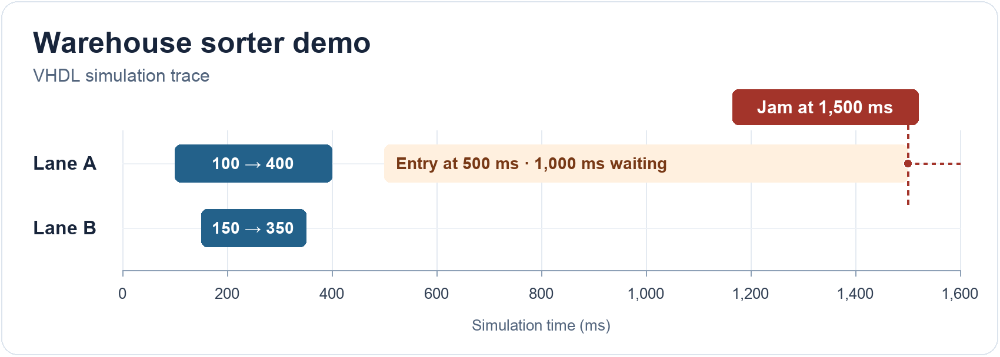
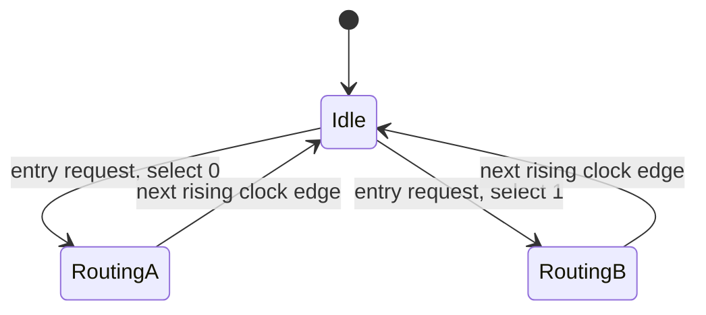

# Warehouse Sorter and Fault Logger

A two-lane warehouse sorter modeled in VHDL, with a C17 analyzer that matches package exits and flags jams. The demo shows a package in lane B finishing ahead of an earlier package in lane A, then catches a second package stalled in lane A.



```text
OK at 350 ms: lane B package exited after 200 ms
OK at 400 ms: lane A package exited after 300 ms
JAM at 1500 ms: lane A package waiting for 1000 ms
```

## Run the demo

With a C17 compiler and Make installed, run `make demo` from the repository root to replay the sample trace. To generate a fresh trace and pass it to the analyzer, install [GHDL](https://github.com/ghdl/ghdl/releases) and run the commands below. Set `GHDL=/path/to/ghdl` when the simulator is outside your PATH.

```sh
make demo-full
make test
```

The simulation writes the event log to `build/trace.csv` and waveforms to `build/trace.vcd`. Run `make test-c` to verify the software independently of GHDL.

## Design



1. **Route packages.** The Moore controller accepts a request on a rising clock edge when ready. The selected route output stays high for one cycle. Synchronous reset returns the controller to idle.
2. **Record events.** The VHDL testbench logs entries from the controller's actual route outputs. Simulated exit sensors and timer ticks supply the rest of the trace.
3. **Match exits and report jams.** The C analyzer keeps a 16-slot FIFO ring buffer for each lane. Each exit removes the oldest arrival from its own lane, so either lane can finish first. At each timestamp, the analyzer checks for a wait of at least 1,000 ms and emits at most one jam alert per package.

### Trace format

```csv
time_ms,event,lane
100,ENTRY,A
400,EXIT,A
500,ENTRY,A
1500,TICK,
```

Events must be in chronological order. An entry or exit takes lane `A` or `B`. A tick has an empty lane field and advances time so a jam can be detected even when nothing reaches an exit. An exit exactly at the timeout counts as a jam. The analyzer reports malformed records, unmatched exits, and full queues with a line number and a nonzero exit status.

## Verification and scope

The VHDL testbench checks routing, mutual exclusion, readiness, busy requests, and reset recovery. The C tests cover FIFO order, interleaved lanes, the timeout boundary, and rejected input. The end-to-end test compares the generated trace and the analyzer report with committed expected results.

This project applies the Moore-state-machine pattern from ENGG*2410 Lab 07 and queue concepts from CIS*2520 to an original warehouse scenario. Results use simulated sensors. A board demonstration would require sensor handling and pin mapping for the selected FPGA.
